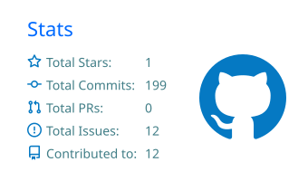
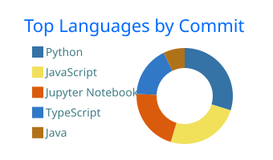

### Hi, I'm Lingesh

I build AI systems that ship — LLM applications, RAG pipelines and agents, plus the APIs and interfaces around them.

Currently an **AI Developer at Home Ideas Technologies**, working on HIT PRO (AI-driven BOQ estimation) and a conversational video assistant. Part-time, I'm an **AI & ML Engineer at Xeve Tech Solutions**, building generative AI workflows for production. Before that, I worked on an LLM research project at **C-DAC**.

B.E. Artificial Intelligence & Machine Learning — Sri Krishna College of Technology, 2026.

[lingesh.vercel.app](https://lingesh.vercel.app) · [LinkedIn](https://www.linkedin.com/in/lingesh-t-a879b5249/) · [lingesh3241@gmail.com](mailto:lingesh3241@gmail.com)

---

#### What I'm working on

- Agentic workflows and multi-agent orchestration
- Retrieval quality — chunking, hybrid search, re-ranking
- Deploying and monitoring LLM services on the cloud

#### Selected work

**[Resolve AI](https://resolve-ai-two.vercel.app/)** 
Takes a reported issue, classifies intent, retrieves similar past cases with semantic search and drafts resolution steps. 
Python · LLMs · Vector search

**[ReplyReady](https://replyready.vercel.app/)** 
Reply generator for email and professional messages, with tone control built on structured prompting. 
FastAPI · React · LLMs

**[DeepVitals](https://github.com/lingesh0/DeepVitals)** 
Estimates vital signs from video without contact, combining spatial and temporal deep learning models. 
PyTorch · CNN · LSTM · Transformers

**[Helmet Violation Detection](https://github.com/lingesh0/helmet-violation-prediction)** 
Real-time detection of riders without helmets from traffic footage, with a monitoring dashboard. 
OpenCV · CNN · Python

**ReviewShield** 
Chrome extension that flags likely fake product reviews using an on-device model. No data leaves the browser. 
JavaScript · TensorFlow.js · WASM

**[Mark2GPA](https://mark2gpa.vercel.app/)** 
SGPA/CGPA calculator supporting multiple grading schemes, with input validation. 
Python

#### Stack

| | |
|---|---|
| **AI / ML** | Python, PyTorch, TensorFlow, scikit-learn, Hugging Face, LangChain, OpenCV |
| **LLM systems** | RAG, vector databases, prompt design, agents, n8n |
| **Backend** | FastAPI, Node.js, Express, Spring Boot |
| **Frontend** | React, Next.js, Tailwind CSS |
| **Data** | PostgreSQL, MySQL, MongoDB, Firebase |
| **Infra** | AWS, Docker, Jenkins, Vercel, Git |

#### Activity

---

Open to collaborating on applied AI and LLM tooling. The fastest way to reach me is email.
